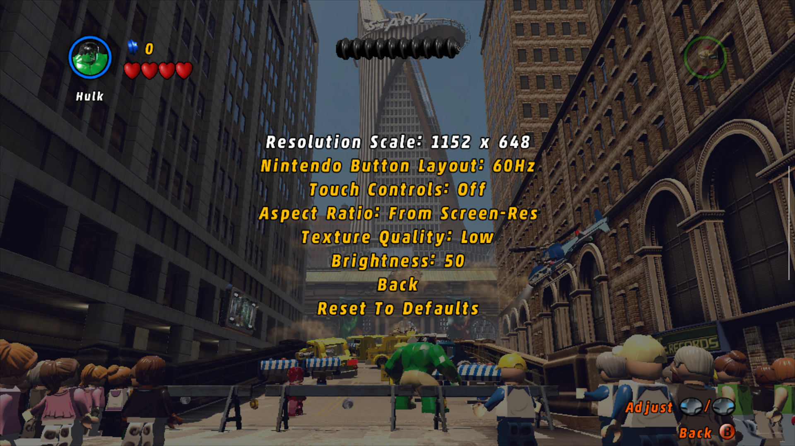

# LEGO Marvel Super Heroes (PC) for Android

An unofficial "native" Android port of the PC version of *LEGO Marvel Super Heroes*. It should run on any arm64 phone with Vulkan 1.1 and is tested on a Snapdragon device with an Adreno 610 GPU (Retroid Pocket Duo Lite, if anyone is curious).

This repository contains no game code or data. You need your own copy of the PC game, which is used as a basis for the recompilation. Personally, I used the Steam version.

Discord: http://discord.gg/df3cK2JCqs

Youtube link below:

[](https://youtu.be/9xGQhgW3Hn0)

## Functionality
- **Static recompilation.** This project is *not* a decompilation but a recompilation; Basically, it's just converting one type of code to another rather than re-creating the original source. The game's own shader compiler (`D3DCompiler_43.dll`) is recompiled too, so shaders are built on the phone.
- **Graphics:** a patched [dxvk-native](https://github.com/Joshua-Ashton/dxvk-native) (native-1.9.2b) translates D3D9 to Vulkan 1.1. You must meet this requirement for the game to even launch, but most devices support it nowadays.
- **Platform:** SDL2 2.30.9 is used for the window, input, audio and the Android activity. There is an optional on-screen overlay for phones without a controller that can be adjusted from the in-game menu.

## Shaders
The game doesn't recognise phone GPUs, so it compiles its shaders while it runs (about 0.6 s each on an Adreno 610). The first launch can sit on a black screen for a while after the logos. Every compiled shader is saved, so each launch is faster than the last.

## Port settings

In-game, under Options > **Video and Port Settings**:
- **Resolution Scale** (0.2 to 1.0): renders at a reduced screen resolution and stretches the image to fill the screen.
- **Touch Controls**: show or hide the on-screen buttons.
- **Nintendo Button Layout**: swaps A/B and X/Y on physical controllers.
- **Aspect Ratio** is always set from the screen resolution.

# Instructions

## Game files you need

Everything comes from your own PC install of *LEGO Marvel Super Heroes* (2013).

| For building on PC | For playing on Android
| :------------------ | -------------------:
| LEGOMARVEL.exe | LEGOMARVEL.exe
| D3DX9_43.dll (32-bit) | D3DX9_43.dll (32-bit)
| D3DCompiler_43.dll (32-bit) | D3DCompiler_43.dll (32-bit)
|| GAME*.DAT (all of them)
|| The rest of the install folder

The two DLLs can stay in the game's `redist` folder. If yours doesn't have them, they are in the DirectX June 2010 redistributable (`Jun2010_d3dx9_43_x86.cab` and `Jun2010_D3DCompiler_43_x86.cab`). The launcher icon is extracted from `LEGOMARVEL.exe` itself.

#### Which executable?

- `LEGOMARVEL.exe` SHA-1 starts with `8fab01d1` (Steam release).
- `D3DX9_43.dll` SHA-1 starts with `f5944df4`, `D3DCompiler_43.dll` with `98be17e1`.
- Check yours with `certutil -hashfile LEGOMARVEL.exe SHA1` (Windows) or `sha1sum LEGOMARVEL.exe`.
- Other releases have different code and are untested. Discovery and lifting should still run on them, but the hooks in `runtime/` and `tools/patch_gen.py` use fixed addresses (menu, options and shader functions) that won't match.


## 1. Building

The build has two stages:
1. Generate `gen/` from your game files. This is slow, runs once, and must be redone only when `tools/lift.py` changes.
2. Build the APK with Gradle, the Android NDK and CMake.

Linux (or WSL) is the easiest host for stage 1. Stage 2 works on Windows, Linux and macOS.

### 1.1 Generate the recompiled code

Requirements: Python 3.10+, plus `pip install capstone==5.0.9 pefile==2024.8.26`. `unicorn==2.0.1.post1` is only needed for `tools/difftest.py`, the lifter self-test.

Put your files (see above) in a folder, called `GAME` here, then run from the repository root:

```sh
tools/regen_gen.sh GAME
```

The script runs discovery and lifting for the three modules (with `LIFT_GAME=marvel`). Any functions the port replaces with host code are renamed `f_<addr>_guest` automatically, via `HOST_OVERRIDES_MARVEL` in `tools/lift.py`, and `tools/patch_gen.py` applies the port's few edits inside generated functions, so no manual edits are needed:

| Module | Load address | Output |
|---|---|---|
| `LEGOMARVEL.exe` | its own (0x400000) | `gen/exe_00.c` … `exe_383.c`, `exe_table.c`, `funcs_exe.h` |
| `D3DX9_43.dll` | 0x08000000 | `gen/d3dx9_*.c` |
| `D3DCompiler_43.dll` | 0x09000000 | `gen/d3dc_*.c` |

Discovery takes a few hours in all. The generated C is around 410 MB.

### 1.2.1 Build the APK

Requirements:
- JDK 17 (Android Studio's bundled JBR works; JDK 21 breaks this project's Gradle 8.1.1).
- Android SDK Platform 34, Build-Tools 34, CMake 3.22.1.
- NDK r27 or newer (built with 29.0.14206865).

Install them with Android Studio's SDK Manager, or from the command line:

```sh
sdkmanager "platforms;android-34" "build-tools;34.0.0" "cmake;3.22.1" "ndk;29.0.14206865"
```

Optionally install the real launcher icon from your copy: `python3 tools/make_icon.py GAME/LEGOMARVEL.exe`.

Then build:

```sh
cd android
# Linux/macOS
./gradlew assembleDebug -PndkVersion=29.0.14206865
# Windows
gradlew.bat assembleDebug "-PndkVersion=29.0.14206865"
```

The APK is written to `android/app/build/outputs/apk/debug/app-debug.apk`.

- The first build takes 30 to 90 minutes (about 430 generated files). Each recompiled file needs 1 to 2 GB of RAM to compile, so parallel compiles are capped with `LB_GEN_JOBS` (default 3). With more RAM, raise it in `android/app/build.gradle` by adding `"-DLB_GEN_JOBS=6"` to the cmake `arguments`.
- `debug` builds still use `CMAKE_BUILD_TYPE=Release`: generated code at `-O1`, the shader compiler and runtime at `-O2`. A real debug build is too slow to play.
- If you apply a patch from an archive, `touch` the extracted files. Archives keep old timestamps, and Ninja will otherwise skip recompiling them.

### 1.2.2 Desktop build (Linux or WSL2, for testing)
`desktop/build.sh` builds dxvk-native and then `build/lb`, a Linux x86-64 binary of the same port, which is useful for debugging with a desktop GPU. It needs clang, cmake, ninja, SDL2 and Vulkan development files. Run it with `desktop/run.sh` or as `build/lb GAME_DIR SAVE_DIR`. Desktop speed doesn't match a phone, so test performance on the phone.

Useful environment variables:
| Variable | Effect |
|---|---|
| `LB_TOUCH=1` | Enables the touch overlay and the phone settings on desktop (mouse = touch). |
| `LB_LOG=n` | Log level. |
| `LB_KEYS`, `LB_KEYFIFO`, `LB_PADONLY=1` | Scripted input for automated tests. |
| `LB_BCEMU=1` | Decodes DXT/BC textures on the CPU. |
| `LB_GPU_VENDOR` | `keep` (default), `intel`, `nvidia` or `amd`: which GPU the game is told it has. |
| `DXVK_HUD=portstatus` | Shows the shader that is compiling. |

## 3. Installing

Requirements: an arm64 Android phone with Android 9 or newer and Vulkan 1.1 (most Snapdragon 6xx/7xx/8xx devices from 2018 on), at least 3 GB of RAM, and about 12 GB of free space.

1. **Install the APK.** Copy it to the phone and open it, allowing "Install unknown apps" for your file manager or browser, or use `adb install -r LegoMarvel-<version>.apk`. Newer versions install over older ones.
2. **Start the app once.** It creates its folders and shows an error because no game files are there yet. Don't skip this: if a PC or file manager creates the folder first, the app isn't allowed to read it.
3. **Copy the game files** listed above into
   `Internal storage/Android/data/com.tj.legomarvel/files/game/`.
   - From a PC: connect by USB (File transfer mode) and copy them in, or run `adb push "<your install>/." /sdcard/Android/data/com.tj.legomarvel/files/game/`.
   - On Android 11+, most phone file managers cannot open `Android/data`. Use a PC, or a file manager with that access.
4. **Start the app.** Self explanatory, but give the first launch time to compile its shaders.

## Controls
- Bluetooth, USB, and integrated controllers should work fine (Xbox layout by default; see Nintendo Button Layout).
- The touch overlay shows a stick, A/B/X/Y, shoulders, Start and Back.

## Troubleshooting
`Android/data/com.tj.legomarvel/files/log.txt` is rewritten on every launch, and `files/last_exit.txt` records why the app last closed, so please attach both if reporting a problem.

These empty files in `Android/data/com.tj.legomarvel/files/save/` change how the port behaves (delete one to undo it):
| File | Effect |
|---|---|
| `multicore.txt` | Lets the game's threads use every CPU core (faster, but it can crash). |
| `serial_shaders.txt` | Compiles shaders one at a time, with an on-screen "Compiling shader" line. |
| `async_shaders.txt` | Draws while shaders compile; objects pop in as they finish. |
| `gpu_vendor.txt` | `keep`, `intel`, `nvidia` or `amd`. Pretending to be a PC GPU makes the game load its full prebuilt shader set up front, which takes 5 to 10 minutes on a phone. |

## Legal
LEGO, Marvel and all related names and assets belong to their respective owners. This project is not affiliated with or endorsed by them. Do not redistribute anything produced from the game or game files. Third-party code keeps its own licenses: SDL2 (zlib) in `android/app/jni/SDL2`, dxvk-native (zlib) in `android/app/jni/dxvk`.
